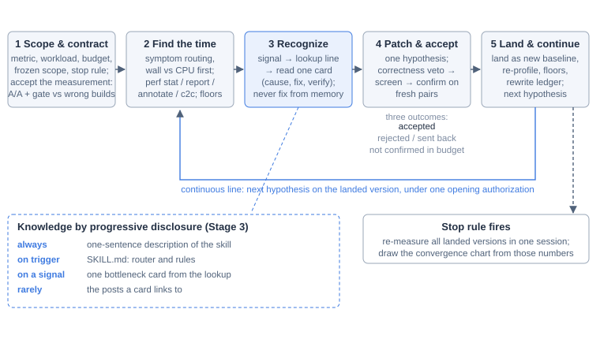
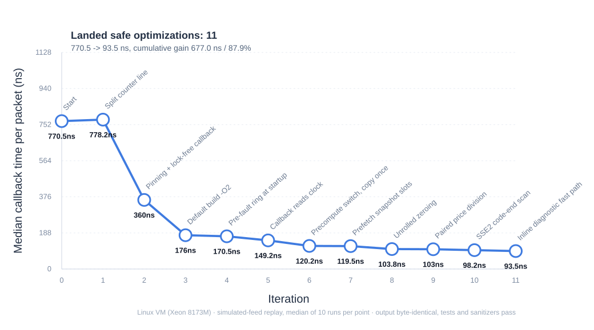
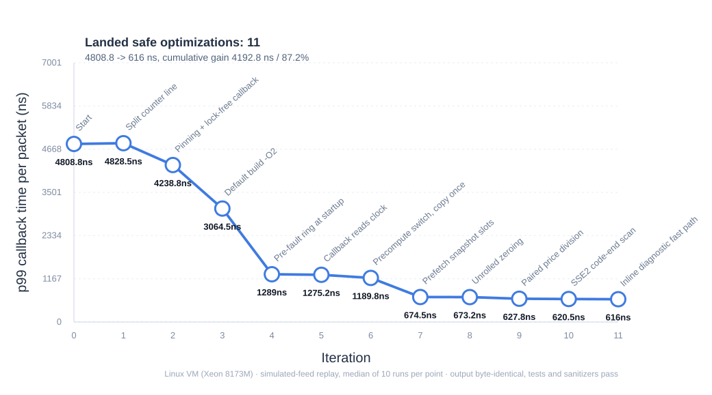

# Reliable Performance Optimization by Coding Agents: From Diagnosis to Accepted Patches

**Research overview** · Junming Liang, Anhui Normal University · July 2026 – present

📄 [Research overview (PDF, 8 pages)](research_overview.pdf) · [Earlier technical report v0.1 (PDF, 9 pages)](paper_v01.pdf)

This repository holds my ongoing research on how a coding agent should carry out performance optimization end to end—diagnosis, patching and acceptance—so that what lands is correct and really faster. The overview below describes the full workflow, packaged as an agent skill, with two cases: a blind test on a public program from a CppCon 2026 talk, where two agents ran a continuous line without seeing the expert's answer and their final versions then passed differential tests, sanitizers and an independent review, and a line on an in-house market-data callback. The earlier technical report and its frozen, reproducible artifact are documented further down.

## 1. Background and Problem

**Application.** The core programs of quantitative trading systems—market-data handling, factor computation, order and position processing—are mostly written in C++ or Rust and are highly sensitive to latency and throughput; engineers routinely iterate for gains of a few percent. They must also be strictly correct: a subtle change in logic can directly affect orders and positions, while existing tests usually cover only typical inputs, so passing them does not mean nothing is broken. Optimization here means being faster without being wrong.

**The agent's job.** A coding agent asked to make such code faster has to do the whole job: find where the time goes, recognize the bottleneck, write a patch, show that the patch is still correct and that its speedup is real, and keep going as the hotspot moves. Agents can propose many candidates in a short time, so two things decide the outcome: whether the agent looks in the right place with the right knowledge, and whether what it lands is correct and genuinely faster.

**Why this is hard.**

- **Measurements are noisy.** On a factor-computation program from my internship, repeated runs of the same build on the same machine varied with a standard deviation of 7–10% of the mean without CPU pinning (about 5% with pinning), while many optimizations gain only a few percent. Isolation reduces the noise, but shared cloud and CI machines often cannot be isolated, and the noise never disappears.
- **Estimates can be biased**, wrong in one direction however many runs are made: run order, memory layout and even the size of the environment can shift a measured speedup [4, 5]. Selection adds more: among 20 useless patches, one or two will look faster by chance, and stopping at the first significant result pushes the error rate far above the nominal 5%.
- **The budget is limited.** Every extra minute spent on one candidate is a minute not spent on another.
- **Knowledge has to arrive at the right moment.** An agent cannot hold a whole performance handbook in its context, and fixing from the model's memory skips the evidence; it needs the right piece of knowledge when a profile shows a signal.

**Research question.** *How should a coding agent carry out performance optimization end to end—diagnosis, patching and acceptance, for one patch or a long line of them—so that what lands is correct and really faster, within a limited budget?* The problem is not unique to my work. [auto_optimization](https://github.com/zjusharkyu/auto_optimization), a public project inspired by Karpathy's autoresearch, lets an agent optimize an order-book program, keeping any change that measures faster than the current best and passes the tests. Five of the seven changes it kept gained only 0.2–0.8% each; no measurement variability is reported, so the records alone cannot confirm these small gains (Figure 1). Chen et al. [1] found that many official reference patches in published agent performance benchmarks, replayed on other machines, do not consistently meet the benchmarks' own validity criteria.


**Figure 1.** The public auto_optimization loop. A change is kept if it beats the current best and passes 14 unit tests; in 30 minutes the agent ran 20 iterations and kept 7, discarding the rest (slower, failed builds or crashes). The benchmark script configures CPU pinning, process isolation and real-time scheduling; each point is the median of 40 runs. Score: mean time for a batch of about 36,000 order messages, in units of 10 µs.

## 2. The Workflow

I packaged the workflow as an agent skill ([performance-optimization-skill](https://github.com/Jasper-aa64/performance-optimization-skill)) that runs in Claude Code and Codex. It has five stages (Figure 2); at every point the agent knows which stage it is in and what to read next. Two principles run through all of them: **correctness is an absolute veto**, and **performance is a statistical judgment made on fresh data under rules fixed in advance**.

<!-- newpage: keep Figure 1 on page 1 and start the stages on page 2; re-check if earlier text changes -->

**Stage 1: Scope, contract, and an accepted measurement.** The request is classified as diagnose, optimize, optimize continuously, or evaluate an existing patch, and read-only discovery comes first. Before any build or timing run the agent writes an experiment contract: metric and units, workload, the allowed changes and what stays frozen, correctness checks, host, budget, stop conditions, and the model that will write patches. The measurement entry must then pass acceptance before any number counts: the same build run as both arms shows no systematic difference, the program state resets reproducibly, and the correctness gate rejects deliberately wrong versions of the kinds the allowed changes risk, such as a lost update or a reordered floating-point sum. A property the gate cannot see is recorded as a gap and checked by reading each landed patch.

**Stage 2: Find the time.** The symptom picks the first evidence: CPU-hot, waiting or I/O, lock contention, poor scaling, or an unreliable measurement, which must be fixed before any code is touched. A cheap discrimination pass, such as wall-clock against CPU time per stage, comes before profiling. For CPU work the agent drills down with perf—stat, then report, then annotate of any function above 20% of samples, and c2c for cross-core contention—following anchored sections of a perf guide rather than its recollection. Virtual machines often expose no hardware counters, so two instrument builds stand in for the missing IPC and miss rates: a *compute floor* does the same work on data shrunk to fit in cache, and a *data floor* keeps the loads and stores but removes the computation. Measured with the real version in one session, they show whether the time is mostly computation or mostly waiting for data.

**Stage 3: Recognize the bottleneck, by progressive disclosure.** Knowledge reaches the agent in layers, so it reads a few small files per task instead of a handbook. Only a one-sentence description is always in context. When the skill is triggered, the agent reads its router and rules. When a profile or source signal appears, it searches a lookup that has one line per bottleneck card and reads only the matching card: the signal, its cause, the fix, how to verify it, and links to the mechanism. The posts behind a card are read rarely. The rule is never to fix from memory: a signal is matched to a card before any edit. A new kind of bottleneck arrives as a new card file and appears in the lookup without any change to the skill.

**Stage 4: Patch, then accept on evidence.** Each candidate carries one reviewable hypothesis and may not change the workload, the correctness oracle, the metric boundary or the gate.

- **Correctness first.** The candidate's outputs must match the baseline's exactly. Where the workload holds only typical inputs, differential tests on boundary and malformed inputs, sanitizers (ASan, UBSan, TSan) and a review by an agent other than the proposer are added. A failing candidate is rejected or sent back however fast it is; a repaired one is a new candidate that inherits no evidence.
- **Screen, then confirm on fresh data.** The original and the candidate run back to back as pairs, in random order. A short screen only selects candidates; the verdict uses fresh confirmation pairs alone, so the luck of selection does not carry over. The test, the sample size and any minimum effect are fixed before measurement, with no early stopping, and the sample size is planned from a run of the same build against itself, so the smallest gain the budget can detect is known in advance.
- **Three outcomes.** Every candidate ends accepted, rejected (or sent back), or not confirmed within this budget, each reported with its machine time.

The two cases below set the parameters from the cost of one run. In the blind test (Section 3) the gate is a bit-exact hash of all tables; a candidate goes on if it screens at least 1% faster, and lands if the 95% t-interval of the per-pair gain over 18 fresh pairs lies above zero, which on the baseline could detect a gain of about 1.1% with 80% probability. In the market-data callback (Section 4) the gate is byte-identical output files plus unit tests, with a whole-program simulation, ASan, UBSan and TSan before landing; confirmation uses 10 fresh pairs and an exact sign-flip test on the median and the p99, because each run already summarizes more than 100,000 packets. Neither case set a minimum effect: both asked only whether each step is real. The skill's default for short runs, a t-interval over fixed time windows with a 1% minimum effect and budgets of 10 minutes for screening and 30 for confirmation, was not used in either case: each run already summarizes a whole workload, so the run pair is the unit, and the sample sizes above were planned from the cost of one run.

**Stage 5: Keep going, then stop and re-measure together.** A *continuous line* does not end at the first landing. One opening authorization fixes, for the whole line, the model, the budget and candidate cap with a reserve for the final re-measure, the allowed changes, the screening and confirmation rules, and the stop rule; within it the agent does not stop to ask. Each candidate is confirmed against the version landed last, never the original, and after each landing the program is profiled again and its floors re-measured, because the hotspot moves. The stop rule counts hypotheses, not patches, and a candidate that loses closes only its implementation: a direction is closed only after an instrument names a cost that the direction itself cannot avoid. After every step the agent rewrites a ledger on disk—the authorization, the landed chain, the floors, the budget spent and the directions tried by cost type—and after a context reset it resumes from the ledger, never from recollection. When the stop rule fires, the original and every landed version are re-measured in one interleaved session, and the convergence chart is drawn from those numbers alone; a step that does not reproduce stays on the chart and is reported.



**Figure 2.** The workflow as the skill runs it. Knowledge is loaded in layers at Stage 3; a confirmed candidate lands and becomes the baseline for the next hypothesis until the stop rule fires.

## 3. Evidence: A Blind Test on a Public Low-Latency Program

**Setting.** The program comes from a CppCon 2026 talk on cache latency in trading code [12]. When a tick arrives, the 64 options written on that stock are repriced, and those whose alpha clears a threshold are collected. One event touches about 140 cache lines spread over large tables. In the talk the author optimizes it by hand in four steps, from a median of 510 to 329 ns on his machine (−35%), without changing the computation. This makes a public program with a known expert answer. I removed every comment that hinted at the author's steps, froze everything except the per-event function, and gave the same opening authorization and the same snapshot of the skill to two agents that had not seen the answer: one line ran Claude Opus 5.5, the other DeepSeek V4.1 Flash. Both ran on the same virtual machine (Skylake-AVX512, no hardware counters, 2 MB huge pages) behind one lock, so their measurements never overlapped. Budget: 8 hours of machine time and at most 30 candidates; stop after 5 consecutive hypotheses without a landing; one extra core allowed; acceptance as in Stage 4.

**Results.** Line B landed four steps: unrolling the alpha chain, prefetching both lines of each option, 4-wide SIMD, and a longer prefetch distance. Line A landed six: computing the 64 alpha chains interleaved with AVX2, page-aligned scratch arrays, moving part of the options to a helper thread on a second core, tuning that split, starting on the first 32 options before the rest of the stock record arrives, and prefetching the completion line for writing. In each line's final re-measure no version was slower than the one before, and the median time per event fell by 66% (B) and 63% (A). I then ported the talk's six-step reference code into the same harness and measured it in one session with both final versions (Figure 3): B was 27.0% faster than the reference's final version (95% CI 25.1–28.8%) and A 22.4% (20.2–24.7%); a second session reproduced both. The comparison holds on this machine only. The talk's steps target waiting for data and were designed on a desktop CPU with an isolated core, while on this virtual machine computation is about 60% of the baseline's time by its compute floor, which favors the agents' changes to the computation. The reference also failed the gate in all 15 runs: when one option appears twice in a stock's list, the batched read-then-write loses an update, and the two-core split lets both cores update the same option. A comparison of timings alone would not show this.


**Figure 3.** The talk's reference steps and the final version of each blind line, ported into one harness and measured in one interleaved session on the same machine; each bar is the mean of 15 runs of the median time per event. The reference loses updates when an option appears twice for one stock, so it fails the bit-exact gate.

**Correctness beyond the frozen workload.** The gate checks one workload, so after both lines ended I applied the rest of Stage 4 to the two final versions. Differential tests on 11 other inputs—64 to 4,096 options, so that one option recurs many times in a stock's list; 1 to 32,768 stocks; uniform and fully concentrated load; and chain lengths of 0, 1 and 24, outside the contract—gave a state hash bit-identical to the original's every time, while the ported reference diverged on all five inputs it was run on, so these tests can fail. ASan, UBSan and TSan builds reported nothing. An agent that had not written the patches then reviewed both against the original. It found no input within the contract that changes the result, but named two dependencies the tests had not exercised, both of which I confirmed: A pins its helper thread to one fixed core and ignores the configured one, and both versions use fused multiply-add, which matches the original only because the frozen compiler flags also fuse the original's multiply-adds. Built with fusion disabled, the original's own hash changes and neither version matches it. Both lie inside the frozen build and core assignment, so they are recorded as gaps in the contract rather than defects.

**What the test exposed.**

- **Both lines stopped far too early.** They used less than one of the eight hours, because a count rule fired first: 5 consecutive misses for B, the 30-candidate cap for A. B tried a two-core split once, found its duplicate check too costly and closed the whole direction; A split the work another way on the same machine, and it landed. Combining A's split with B's loop afterwards, which I did after reading both ledgers and so not blind, was another 5.7% faster than B.
- **Progressive disclosure worked at the start, then ran out.** On the baseline both lines matched the cards for a serial accumulation and for vectors that were too narrow. Once the time moved to waiting for data, the largest steps—B's prefetching of both lines and A's two-core split—had no card to match, since all 14 cards were on the computation side, and the route to the memory guide took two hops that neither line followed. Both relied on the model's own knowledge there.
- **The gate missed one class of wrong patch:** reordering a sum whose result happened to be the same on the test data. I checked the operation order of every landed version by reading the code.

These findings changed the skill: the stop rule counts hypotheses rather than patches, a direction closes only on its own measured cost, the gate is accepted against deliberately wrong versions such as lost updates and reordered sums, and waiting for data routes straight to the memory guide.

## 4. Evidence: A Continuous Line on a Market-Data Callback

**Setting.** The target is the per-packet callback of an in-house market-data receiver written in C++: it converts each feed record into the internal layout and writes it into a shared ring, from which a writer thread saves it to files. Each run replays about 200,000 packets from a simulated feed of two exchanges on a virtual machine (Xeon 8173M) without hardware counters and yields the median and the p99 of per-packet time. Only the callback path and its startup precomputation could change; the other threads, the ring layout, the core assignment and the compiler flags were frozen. Budget: 4 hours with 45 minutes reserved for the final re-measure, at most 10 hypotheses, stop after 3 consecutive misses; acceptance as in Stage 4, after the gate had rejected a deliberately broken build that copies a security code one character short.

**Five of six hypotheses landed**, each confirmed against the version before it:

- prefetching all ring slots of a snapshot packet before writing them: p99 from 1274.5 to 691.5 ns;
- zeroing small records with unrolled 16-byte stores instead of `rep stos`: median from 120.7 to 104.2 ns;
- dividing snapshot prices two at a time with `divpd`, bit-identical to dividing one by one: p99 from 669.2 to 633.2 ns;
- finding the end of a security code with SSE2 byte compares: median from 103.2 to 96.7 ns;
- inlining the fast path of two diagnostic checks and marking the slow path cold: median from 98.5 to 93.6 ns.

Hidden symbol visibility failed its screen. Part of the fifth hypothesis, a shortcut that skips a per-thread check, was withdrawn before measurement: a new thread can reuse the handle of a thread that has exited, and the shortcut would then miss it. The line stopped on budget after the sixth hypothesis.

**Convergence.** This line took the median from 120.2 to 93.5 ns (−22%) and the p99 from 1189.8 to 616 ns (−48%). The final re-measure ran 12 versions in one session, 10 runs each in rotating order: the starting point, six optimizations landed on this program before the line under earlier criteria, and this line's five; from the starting point the median fell from 770.5 to 93.5 ns. Two earlier gains did not reproduce and stay on the charts (Figures 4 and 5): moving the ring counters onto their own cache line, which had been measured on the function alone, made no difference in whole-program replay, and the p99 gain of the SSE2 step did not reproduce, although its median gain did. The final median was 1.5 ns above its compute floor and the p99 no higher than its data floor, both measured on the frozen layout; what remains is mostly frozen cost, such as one clock read per record (about 22 ns) and the atomic claim of a ring slot.



**Figure 4.** Median per-packet callback time of every landed version, re-measured together; each point is the median of 10 runs. Points 1–6 were landed before the line, points 7–11 by it. Point 1 did not reproduce in whole-program replay and stays on the chart.



**Figure 5.** The same versions and runs, p99 of per-packet callback time. Points 1 and 10 did not reproduce on this metric and stay on the chart.

## 5. Related Work

**LLM agents and performance.** PIE [2] trains and prompts models to make performance-improving edits to C++ programs and scores them by speedup on a simulator, so that timing noise does not enter. Repository-level benchmarks such as GSO, SWE-Perf and SWE-fficiency compare agent patches with official reference patches by measured runtime; Chen et al. [1] replayed those reference patches on four cloud machine types and found that many do not meet the benchmarks' own validity rules on every machine. SysTradeBench [3] evaluates LLM-generated trading systems through an iterative build-test-patch loop with drift-aware diagnostics. These works measure how capable agents are. My question is how an agent should do the work itself: where it looks, what knowledge it reads, and when one patch, or a long line of them, may be accepted on a given machine within a given budget.

**Measurement bias and rigor.** Mytkowicz et al. [4] showed that changes that look harmless, such as the size of the environment or the link order, can bias a measured speedup; STABILIZER [5] re-randomizes memory layout during execution so that such effects average out. Georges et al. [6] and Kalibera and Jones [7] set out statistically sound methods for repeated measurement and for deciding how many repetitions to run at each level. Stage 4 takes randomized run order, fresh confirmation data and sample sizes planned in advance from this work, and applies them to candidates that agents generate in large numbers.

**Noisy shared machines.** Duet benchmarking [8] runs the two versions side by side on the same cloud machine so that shared interference affects both; TUNA [9] deals with noisy measurements while tuning configurations in the cloud; FBDetect [10] catches regressions of a small fraction of a percent in production. The paired, interleaved runs here follow the idea of Duet at the level of single runs, and the open question on budgets in Section 6 is the trade-off between cost and resolution that these systems face at larger scale.

**Statistics.** The confirmations use paired t-intervals and exact sign-flip (permutation) tests [11]. The contribution is not new statistics, but how an agent gathers evidence and reaches verdicts when it keeps generating candidates.

## 6. Contributions and Next Steps

**Contributions.** I designed an end-to-end workflow for performance optimization by coding agents and packaged it as an agent skill: an experiment contract and an accepted measurement before any number counts; symptom-routed diagnosis with perf, and two floors where hardware counters are missing; bottleneck knowledge delivered by progressive disclosure, one card per signal; one hypothesis per patch, with correctness as an absolute veto and speedups confirmed on fresh data under rules fixed in advance; and a continuous line that keeps landing confirmed patches under one authorization, with a ledger on disk and a final re-measure in one session. In a blind test on a public program from a CppCon 2026 talk, agents from two vendors ran the line to its stop rule; on that machine, where computation dominates, both final versions were 22–27% faster than the speaker's hand-optimized code, and the gate caught a lost-update bug in that code; differential tests on 11 further inputs, sanitizers and an independent review found no defect in either final version. On an in-house market-data callback the line landed five of six hypotheses, cutting the median per-packet time by 22% and the p99 by 48%, and its final re-measure showed that two earlier gains did not reproduce.

**Open questions and next steps.**

- **Stopping.** Both blind lines stopped on a count rule with seven of their eight hours unused. Next: stop only when every listed direction (computation, data access, parallelism) has been tried or closed by its measured cost, set caps by the cost of a candidate, and rerun the blind test to see how much further the lines go.
- **Knowledge.** The cards covered only the computation side, and the route to the memory guide was too long to be followed. Next: add cards for too few reads in flight and for cross-core handoff, and measure whether they change what agents find.
- **False landings.** Each confirmation controls its own error rate, but how often a line of many candidates lands a change with no real benefit is untested. Next: feed no-op candidates, such as comment-only patches, through a line and count how many land.
- **Correctness.** The gate missed reordered sums, and whether the checks are complete is untested. Next: make the gate sensitive to operation order, and inject known bugs to measure missed bugs and wrongly rejected valid patches.
- **Budget and environment.** The gains in both cases were far larger than the smallest gain a budget can resolve. Next: slow a program by a known 1–5% to find the smallest gain a given budget confirms, on pinned machines and in cloud and CI, and repeat confirmation across days.

Longer term, I want to study whether feeding this evidence back to the agents improves their patches.

## References

1. Z. Chen, Z. Sun, Y. Shi, D. Lo, L. Jiang. Are Performance-Optimization Benchmarks Reliably Measuring Coding Agents? [arXiv:2607.01211](https://arxiv.org/abs/2607.01211), 2026.
2. A. Shypula, A. Madaan, Y. Zeng, U. Alon, J. Gardner, M. Hashemi, G. Neubig, P. Ranganathan, O. Bastani, A. Yazdanbakhsh. Learning Performance-Improving Code Edits. ICLR, 2024.
3. Y. Cao, H. Zhang, J. W. Keung, Y. Chen, L. Song. SysTradeBench: An Iterative Build-Test-Patch Benchmark for Strategy-to-Code Trading Systems with Drift-Aware Diagnostics. [arXiv:2604.04812](https://arxiv.org/abs/2604.04812), 2026.
4. T. Mytkowicz, A. Diwan, M. Hauswirth, P. F. Sweeney. Producing Wrong Data Without Doing Anything Obviously Wrong! ASPLOS, 2009.
5. C. Curtsinger, E. D. Berger. STABILIZER: Statistically Sound Performance Evaluation. ASPLOS, 2013.
6. A. Georges, D. Buytaert, L. Eeckhout. Statistically Rigorous Java Performance Evaluation. OOPSLA, 2007.
7. T. Kalibera, R. E. Jones. Rigorous Benchmarking in Reasonable Time. ISMM, 2013.
8. L. Bulej, V. Horký, P. Tůma, F. Farquet, A. Prokopec. Duet Benchmarking: Improving Measurement Accuracy in the Cloud. ICPE, 2020.
9. J. Freischuetz, K. Kanellis, B. Kroth, S. Venkataraman. TUNA: Tuning Unstable and Noisy Cloud Applications. EuroSys, 2025.
10. D. Y. Yoon et al. FBDetect: Catching Tiny Performance Regressions at Hyperscale through In-Production Monitoring. SOSP, 2024.
11. P. I. Good. Permutation, Parametric, and Bootstrap Tests of Hypotheses. Springer, 2005.
12. S. Gupta. Talk at CppCon 2026 on cache latency in a trading hot path; slides "The Latency Slippage" and code at [github.com/0xsanchit/CacheLatency](https://github.com/0xsanchit/CacheLatency).

---

## Earlier technical report (v0.1): Selective Authorization of Automated Performance Patches

**Rule Audit and Case Study of a Frozen Promotion Gate**
Junming Liang, Anhui Normal University — Technical Report v0.1, September 2026

📄 **[Read the paper (PDF, 9 pages)](paper_v01.pdf)**

---

### What this is

Coding agents can propose performance patches faster than noisy hardware can
validate them. That creates an authorization problem distinct from patch
generation: *when is the evidence strong enough to permit automatic promotion?*

This report takes one **frozen** promotion gate — a paired-measurement rule
combining a minimum practical effect, a bootstrap confidence interval, a paired
permutation test, a sign-consistency threshold, and a bounded 4/8/12 sample
ladder — and does two things with it:

1. **Audits the rule.** What can this decision procedure actually certify, and
   what does it only appear to certify?
2. **Runs a preregistered public case study.** How does it behave on fmt 12.1.0
   under 30 strict A/A nulls and one real candidate?

The gate was frozen *before* the study. The audit does not propose a
replacement policy.

### Main findings

**The sample budget cannot support the sign threshold as a confidence claim.**
The gate requires sign consistency ≥ 0.9. If that is read as a claim about an
underlying probability *q*, then under an IID Bernoulli-sign model, rejecting
`q ≤ 0.9` at one-sided 5% significance needs **at least n = 29 observations**,
and at that minimum **every one of the 29 paired differences must be positive**
(since `0.9^28 = 0.05233 > 0.05 ≥ 0.9^29 = 0.04710`). The frozen ladder stops at
12. The threshold is therefore usable as a heuristic filter, not as a
95%-confidence statement.

**Arm order is not identifiable.** Odd pair indices always ran the candidate
first and even indices always ran the control first; 0 of 244 null pairs
violated this mapping. Arm order is therefore perfectly confounded with
pair-index parity, and an arm-order effect cannot be estimated.

**The gate promoted 0 of 30 strict A/A nulls** (one-sided 95% upper bound
9.503%, *under an independent common-probability Bernoulli model*), where a
deliberately weak first-pair counterfactual would have accepted 16 of 30.
**This must be read together with the fact that all null candidate and control
binaries were byte-identical and shared one hash.** The result calibrates the
end-to-end pipeline on strict A/A inputs; it says nothing about sensitivity to
binary-distinct but semantically equivalent patches.

**The one real candidate was not auto-promoted.** A buffer-reuse change showed
a median paired gain of 35.861 ms (6.515%) but ended as
`accepted_noisy_single` — an evidence-only verdict requiring independent
replication, because 7 of 8 pairs were positive (0.875) against a 0.9 sign
threshold.

### What this does *not* claim

- No universal false-promotion rate for automated performance gates.
- No claim that this gate is better than any alternative.
- No cross-system generality: one target, one host, one frozen configuration.
- No power estimate — there is exactly one real candidate.
- The next-stage simulation contract referenced in §8 is **unexecuted**; all
  related policy comparisons are prospective.

### Reproducing the numbers

Every number in the paper is emitted by a script that reads only the public
artifact — it never touches raw execution evidence:

```bash
python paper_numbers/reproduce.py
```

Expected: `RESULT: all claims reproduced` (86 checks, exit 0). Requires Python
3.9+, standard library only.

Regenerate the three figures:

```bash
python paper_numbers/figures.py
```

Rebuild the PDF (needs a LaTeX distribution):

```bash
cd paper_v01/source && pdflatex main && bibtex main && pdflatex main && pdflatex main
```

### Repository layout

| Path | Contents |
|---|---|
| `paper_v01.pdf` | the paper |
| `paper_v01/source/` | LaTeX source and bibliography |
| `paper_numbers/` | number reproducer, figure generator, vector figures |
| `harness/` | curated subset of the generation-and-timing side (see Scope of harness/) |
| `v2_fmt_public_formal_experiment/publication_v2/` | the frozen public artifact |

The artifact contains typed pair-level evidence for all 31 candidates
(`candidate_evidence.jsonl`), the extracted frozen judge (`frozen_judge_v1.py`),
fixed differential cases, custody and inventory hashes, a self-contained
recomputer (`recompute_public.py`), and an external-consumer acceptance record.
See `publication_v2/README.md` for its own manifest.

### Scope of harness/

`harness/` is the side that produces and times candidate patches; the paper
audits the **decision** side. This is a curated subset, not the full loop —
the execution scripts that drive the measured binaries are intentionally
excluded, so this code demonstrates the design but **does not run
end-to-end**.

### Provenance

AI coding assistants supported repository implementation, evidence checking,
and manuscript drafting. The public package does not retain
candidate-by-candidate model attribution, so this report does not claim that every fmt
candidate was agent-generated. The author defined and froze the protocol,
authorized execution, interpreted the evidence, and is responsible for every
claim. No model-generated number is treated as evidence — values were accepted
only when reproduced by the deterministic recomputer. Full statement in §9 of
the paper.

### Status

Technical report, not peer reviewed. Corrections and replication attempts are
welcome via issues.

### Version history

- v0.1.1 (tag): initial public release (frozen artifact + paper + number
  reproducer).
- Latest (post-v0.1.1): Threats to Validity now quantifies the arm-order
  confound — candidate-first minus control-first over the pooled 244 null
  pairs is 5.373 ms in means and 4.733 ms in medians, about 1.972x the median
  practical-effect threshold the gate applies; the text states plainly that
  the contrast cannot be attributed to arm order, to position within a run,
  or to any other time-varying cause. Pervasive noise flagging (all 31
  candidates `NOISY`) is reported without attributing the dispersion to any
  source. The number reproducer adds the five A10b checks for these values.
  The PDF is rebuilt from the same LaTeX source with a deterministic build
  (`SOURCE_DATE_EPOCH` + `\pdftrailerid{}`). The hash reproduces on the
  same TeX distribution; a different distribution yields different bytes.
  SHA-256 of the published build:
  SHA-256: `DC243D91CE661171689A4D8D54C9452CA0AC8C713235E7FC5EB5D3E55DE0B364`.

### Licensing

This repository uses file-specific licenses; see [LICENSE](LICENSE) for the
complete scope. The four reproduction/judge Python scripts are MIT-licensed,
and the listed JSON/JSONL evidence files are CC BY 4.0. The paper, bibliography,
README files, narrative reports and three committed figure PDFs remain all
rights reserved. The figure-generation code is MIT even though the separate
committed figure PDFs are reserved. These notices do not alter any bytes in
the frozen public artifact.
